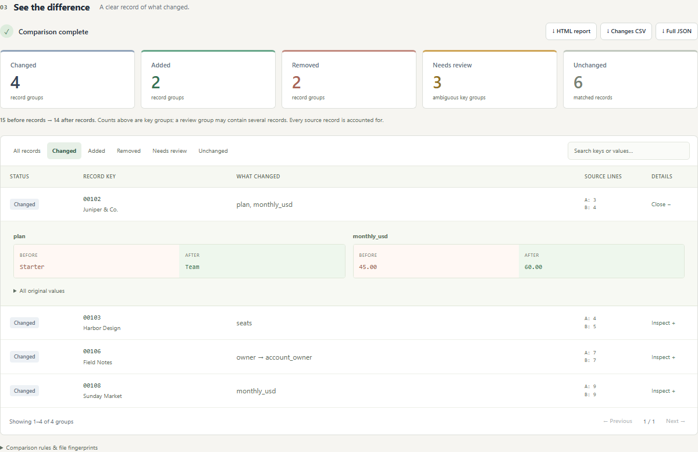

# Row Witness

**Know what changed between two exports. Keep your files on your computer.**

Drop in two CSV files, choose the columns that identify a record, and see additions, removals, changed cells, and matches that need your review. Download a complete report you can open without an account, a server, or an internet connection.

Row Witness is a small, open-source application that fits in one HTML file. It compares text deterministically. There is no AI service, upload endpoint, telemetry, or subscription.



## Try it

1. Download **[row-witness.html from v0.1.0](https://github.com/Buzburg/row-witness/releases/download/v0.1.0/row-witness.html)**, or build it from source below.
2. Open the downloaded file in a modern browser.
3. Choose **Try a sample comparison** to compare realistic synthetic customer exports, or select your own before and after files.
4. Set the key and comparison columns, run the comparison, and export the results.

The downloaded application works offline, including comparison and report generation. You can keep a copy with your files or host the same static file on your own server. Your browser does not need to upload source files to run it.

Want files to experiment with? The [synthetic customer exports and recipe](examples/) reproduce the built-in sample: 4 changed, 2 added, 2 removed, 3 Needs review groups, and 6 unchanged groups.

## What it handles

- UTF-8 CSV and TSV, including quoted delimiters, escaped quotes, multiline cells, byte-order marks, and common line endings.
- Comma, semicolon, tab, or pipe delimiters, with automatic detection and an explicit override.
- Different column names between exports: map `Customer ID` to `customer_id` yourself.
- Keys made from one or more columns. Row and column reordering do not create changes.
- Exact string comparison by default, so `001` stays `001`. Optional whitespace trimming and case folding apply to both keys and compared cells and appear in every report.
- **Duplicate and blank keys stay visible.** They become **Needs review** groups containing every original record; the application never picks a winning duplicate for you.
- Search, status filters, and paginated results. Downloads contain the full relevant result set, independent of the current view.
- A reusable configuration recipe containing column mappings and options, without filenames or data rows.

### A small example

Before:

```csv
item_id,price
001,12.00
002,15.00
```

After:

```csv
sku,price
002,15.00
001,13.00
003,8.00
```

Map `item_id` → `sku` as the key and `price` → `price` for comparison. The result is one changed group (`001`), one unchanged group (`002`), and one added group (`003`). Reordering `002` did not matter.

## Reports you can inspect

| Export | Contents |
| --- | --- |
| **HTML report** | A scriptless, standalone report with every comparison group, every original source record, changed cells, source line references, mappings, options, excluded columns, and SHA-256 fingerprints. |
| **Changes CSV** | One metadata record, then one record for **each original source row** in added, removed, changed, or Needs review groups. Both sides of a change and every conflicting row are included. Unchanged groups are omitted. |
| **JSON evidence** | Versioned, complete evidence with exact original strings, all source records, and the comparison configuration. |
| **Recipe JSON** | Column mappings and comparison options only. Column names can still reveal your schema, so review a recipe before sharing it. |

**Counts are comparison groups, not source rows.** A duplicate-key group might contain three before records and two after records. It counts as one group, while all five original records remain available. Source line references identify the physical starting line in the original file; multiline records can span several lines.

“Unchanged” refers to the fields selected for comparison under your chosen options. Excluded fields can differ. **Complete reports include excluded fields and original values**, so they may contain sensitive information even when those fields were not compared. Search and filtering do not redact exports.

The CSV export adds an apostrophe to cells that could be interpreted as spreadsheet formulas, including common formula prefixes after whitespace. This reduces a known risk; spreadsheet import settings and applications differ, so it is **not a universal safety guarantee**. The apostrophe changes the CSV representation. Use HTML or JSON when you need exact strings. A SHA-256 fingerprint identifies the source bytes; it does not authenticate who produced them or certify that their contents are correct.

## Limits

- Each input: **10 MiB, 100,000 data records, 200 columns, 2,000,000 cells including headers**. Each column name is limited to 512 characters. Very large result reports can still consume significant browser memory.
- UTF-8 only. Convert other encodings before import. Ambiguous or malformed input needs correction or an explicit delimiter choice.
- CSV/TSV only: no `.xlsx`, workbook formulas, PDF, database, or live-service connectors.
- No numeric or date conversion, fuzzy matching, tolerances, accounting decisions, or changes to original files. `1.0` and `1.00` differ in exact mode.
- Comparison runs in a cancellable worker. Exporting a large report is synchronous and may briefly pause the page.
- HTML reports have a 64,000,000-character output budget. If a complete report would exceed it, export fails with a clear message; it never silently truncates. Use JSON evidence or compare smaller files in that case.
- Input data is kept in memory, not saved in browser storage. Reset or reload to clear the current session. Downloaded files remain wherever you save them. Other browser extensions or software on the device are outside the application's control.
- This is a new project. Review important results against the source exports before acting on them.

## Build and develop

Use Node.js 22 or later and npm.

```sh
git clone https://github.com/Buzburg/row-witness.git
cd row-witness
npm ci
npm run check
npm test
npm run build
npm run test:e2e
```

The build produces `dist/row-witness.html`. Open it directly in your browser. Dependencies are needed to build and test, but the generated application has no runtime downloads. Browser test setup is documented in [CONTRIBUTING.md](CONTRIBUTING.md).

See the [acceptance contract](docs/SPEC.md), [research and existing alternatives](docs/RESEARCH.md), and [security notes](SECURITY.md). Bug reports with small synthetic CSV examples are particularly helpful.

## License

[MIT](LICENSE) · Copyright 2026 Buzburg.
